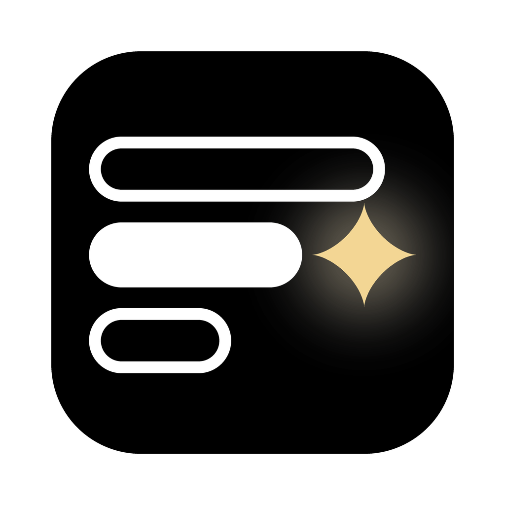
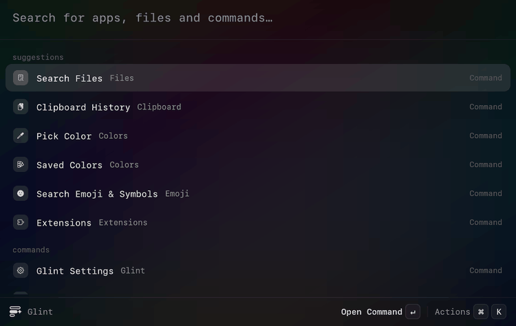
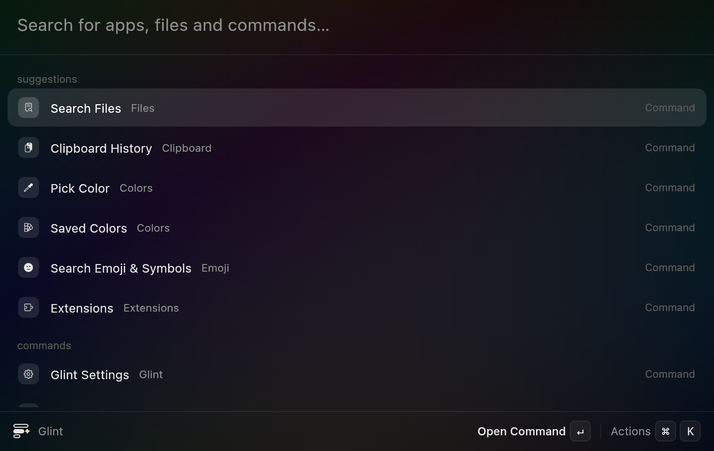
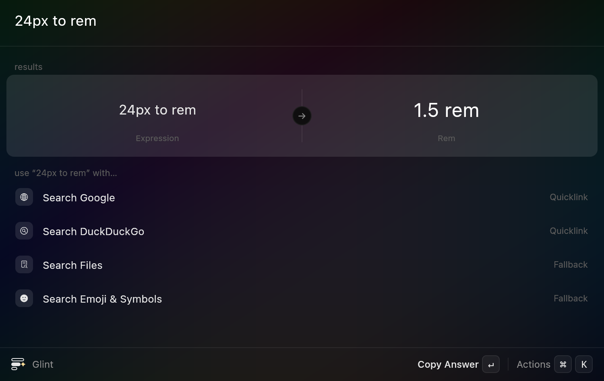
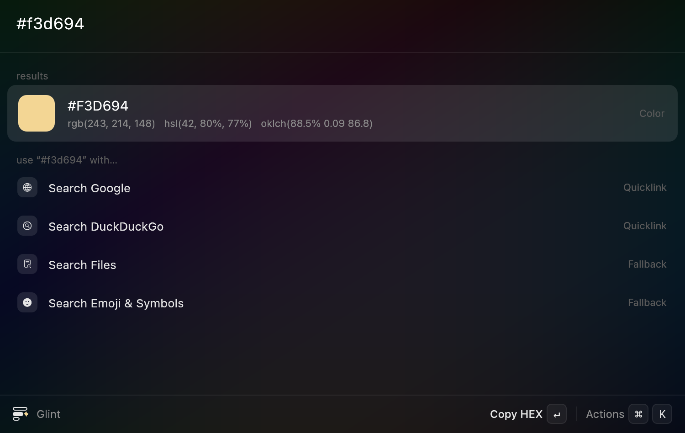
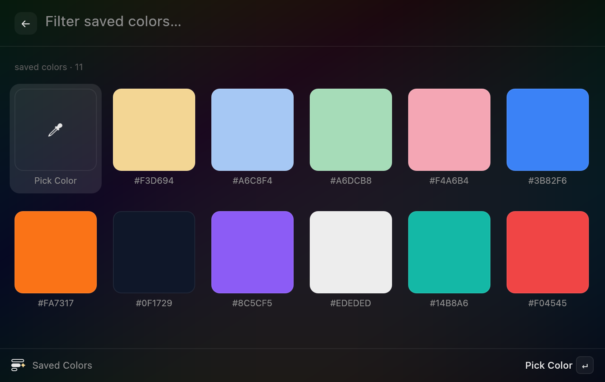
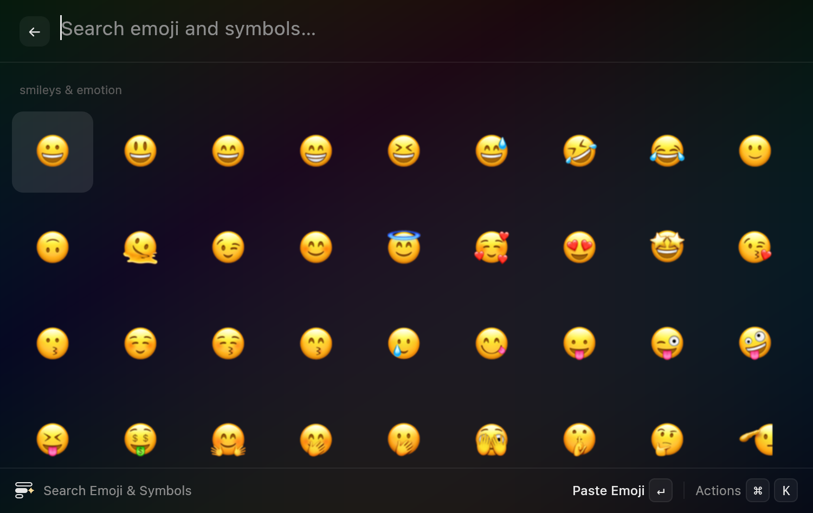
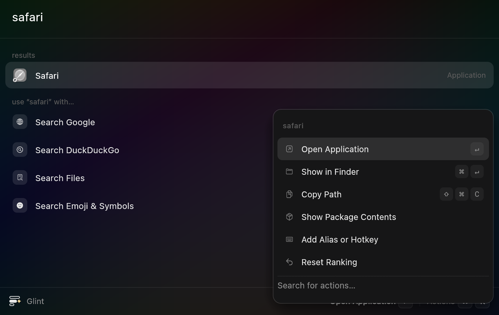
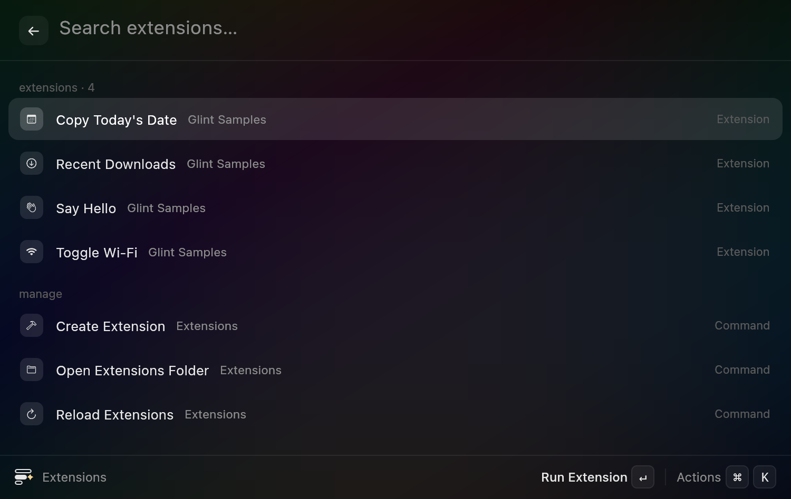
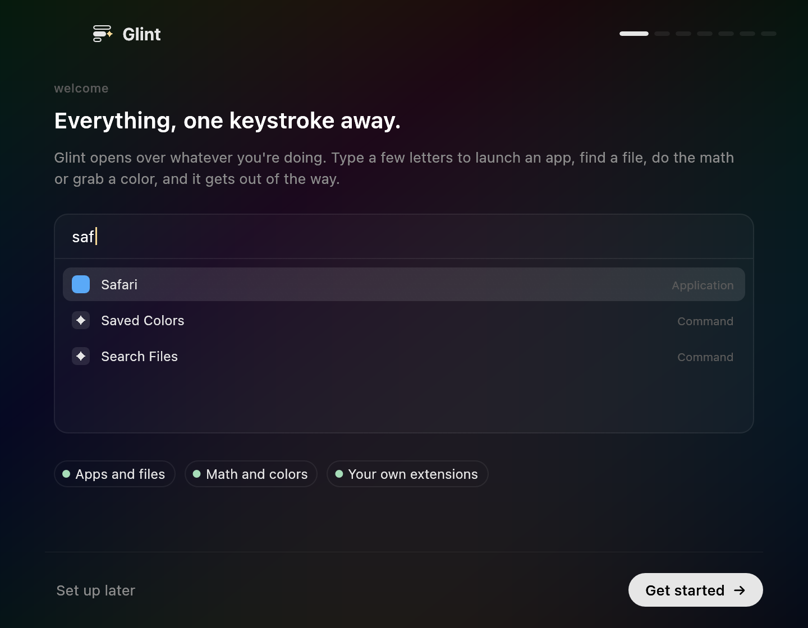

<p align="center"></p>

<h1 align="center">Glint</h1>

<p align="center">Everything, one keystroke away.</p>

Glint is a lightning fast launcher for macOS and a Spotlight replacement. Press the hotkey, type a few letters, and open an app, find a file, do the math, grab a color or run one of your own scripts. Then it gets out of the way.

It's a Raycast alternative written in 100% Rust: one small native binary, no Electron, no Node, no web view. It's free and MIT licensed, lives in the menu bar, and keeps its window loaded while hidden, so it appears the instant you press the key.

<p align="center"></p>

## See it

<table>
<tr>
<td width="50%"><br><b>Search everything.</b> Apps, files, commands, settings panes, quicklinks and extensions, ranked by what you pick most.</td>
<td width="50%"><br><b>Calculate as you type.</b> Math, percentages and units, like <code>24px to rem</code>, <code>3 ft in cm</code> or <code>100 + 15%</code>.</td>
</tr>
<tr>
<td><br><b>Convert colors.</b> Type <code>#hex</code>, <code>rgb()</code>, <code>hsl()</code> or <code>oklch()</code> and copy it in any format.</td>
<td><br><b>Pick and keep colors.</b> The system eyedropper with its magnifier, a saved palette, and shade ramps from 50 to 950.</td>
</tr>
<tr>
<td><br><b>Emoji and symbols.</b> Search them by name and paste straight into the app you were using.</td>
<td><br><b>Actions on everything.</b> <code>⌘K</code> lists what you can do with the selection: Show in Finder, Quick Look, Copy Path, Quit and more.</td>
</tr>
<tr>
<td><br><b>Your own extensions.</b> Scripts in any language become commands. Existing Raycast script commands run unchanged.</td>
<td><br><b>A real welcome.</b> Onboarding walks you through the hotkey, permissions and a hands-on tour that ticks off as you go.</td>
</tr>
</table>

## What's inside

- **App launcher** with fuzzy matching (`vsc` finds Visual Studio Code) and learned ranking.
- **File search** through Spotlight's own index, so there's nothing to build or keep fresh. Results show in root search and in Search Files, with a detail pane.
- **Calculator** with percentages, functions and unit conversion across length, mass, temperature, data, time, volume and CSS units. Calculator History keeps your answers.
- **Clipboard History** for text and files, with pinning, search and a preview pane. Items copied by password managers are never saved.
- **Colors:** Pick Color, Saved Colors, inline conversion and shade ramps you can copy as CSS variables or JSON.
- **Emoji & Symbols** search.
- **Quicklinks** with `{query}` placeholders (Google, DuckDuckGo, GitHub, YouTube, Wikipedia, Maps and Define Word come built in) and **Snippets** with `{clipboard}`, `{date}` and `{time}`.
- **System commands:** Lock Screen, Sleep, Restart, Shut Down, Log Out, Empty Trash, Eject All Disks, Toggle System Appearance, Toggle Hidden Files, Hide Others, Quit All Apps, Mute and volume, Screen Saver, and Quit Applications for anything running.
- **System Settings panes** searchable by name.
- **Aliases and hotkeys** for any command, app, extension or quicklink.
- **Fallbacks:** when nothing matches, use the text for a web search, a file search or an emoji search.
- **Signed auto-updates** from GitHub releases.

## Install

1. Download `Glint.zip` from the [latest release](https://github.com/dyascj/glint/releases/latest) and move `Glint.app` to `/Applications`.
2. Glint isn't notarized by Apple, so the first launch needs a right-click on `Glint.app`, then **Open**. You can also clear the download flag in Terminal:
   ```sh
   xattr -dr com.apple.quarantine /Applications/Glint.app
   ```
3. Onboarding asks for your hotkey. The default is `⌥ Space`; **Use ⌘ Space** turns off Spotlight's shortcut and gives it to Glint, and you can undo it any time.

Accessibility access is optional. It only lets Glint press `⌘V` for you when you choose a clipboard item, snippet or emoji. Without it, Glint copies and you paste.

Updates install from the menu bar with one click. Glint checks GitHub once a day and verifies every download against a signing key built into the app before swapping it in.

## Keys

| Keys | Action |
|---|---|
| your hotkey | Open or close Glint |
| `↑` `↓` or `⌃N` `⌃P` | Move the selection |
| `↵` | Run the selected item |
| `⌘↵` | Its second action (Show in Finder, Copy, ...) |
| `⌘K` | All actions for the selection |
| `esc` | Clear the search, go back, then close |
| `⌫` on an empty search | Go back |
| `⇥` | Next field in arguments and forms |
| `⌘,` | Settings |

## Extensions

An extension is any executable script in `~/Library/Application Support/Glint/Extensions` (or one folder below it) with metadata comments at the top. Glint picks up new and changed files within a second.

```sh
#!/bin/bash
# @glint.title Say Hello
# @glint.mode fullOutput
# @glint.icon hand.wave
# @glint.packageName My Extensions
# @glint.argument1 { "type": "text", "placeholder": "Name" }

echo "Hello, $1!"
```

| Mode | What happens |
|---|---|
| `fullOutput` | The output fills the launcher, with Copy Output and Run Again |
| `compact` | Glint closes and shows the last line in a small HUD |
| `silent` | Runs in the background |
| `inline` | The first line of output becomes the item's subtitle in search |
| `list` | Glint's own: the script gets the search text as `$1` and prints JSON items to search through |

A `list` extension prints an array like this. Each item can `copy`, `open` (a URL or `file://` path) or `paste`:

```json
[{ "title": "Glint", "subtitle": "github.com/dyascj/glint", "icon": "link", "open": "https://github.com/dyascj/glint" }]
```

`icon` takes an [SF Symbol](https://developer.apple.com/sf-symbols/) name like `hand.wave`, or a path to an image, so extensions sit in the list with the same icons as everything else. Up to three arguments are supported (`text` or `password`, with `"optional": true`). `@glint.keywords`, `@glint.description`, `@glint.packageName` and `@glint.currentDirectoryPath` work too.

**Raycast script commands work as is.** Glint reads the `@raycast.` metadata, so you can drop scripts from [raycast/script-commands](https://github.com/raycast/script-commands) into the Extensions folder. Settings › Extensions › Add Samples installs four examples, one for each common mode.

## Privacy

Everything stays on your Mac. Glint has no account and no analytics, and the only request it makes on its own is the daily update check against GitHub. File search reads Spotlight's index; clipboard history, colors, snippets and quicklinks are plain JSON files in `~/Library/Application Support/Glint`.

## Build from source

```sh
cd app && cargo test && cargo run
scripts/bundle.sh          # dist/Glint.app, ad-hoc signed
```

Dev builds never self-update. `GLINT_UI_SNAPSHOT=out.bmp` renders a window to a file without needing Screen Recording permission (`GLINT_QUERY`, `GLINT_VIEW` and `GLINT_UI_PAGE` pick what to show).

Releases are cut by pushing a `v*` tag that matches `app/Cargo.toml`. CI builds a universal binary, signs it with the project certificate, signs the downloads with minisign and publishes them with the notes in `release-notes/`.

## License

MIT. Glint is an independent project and isn't affiliated with Raycast or Apple.
